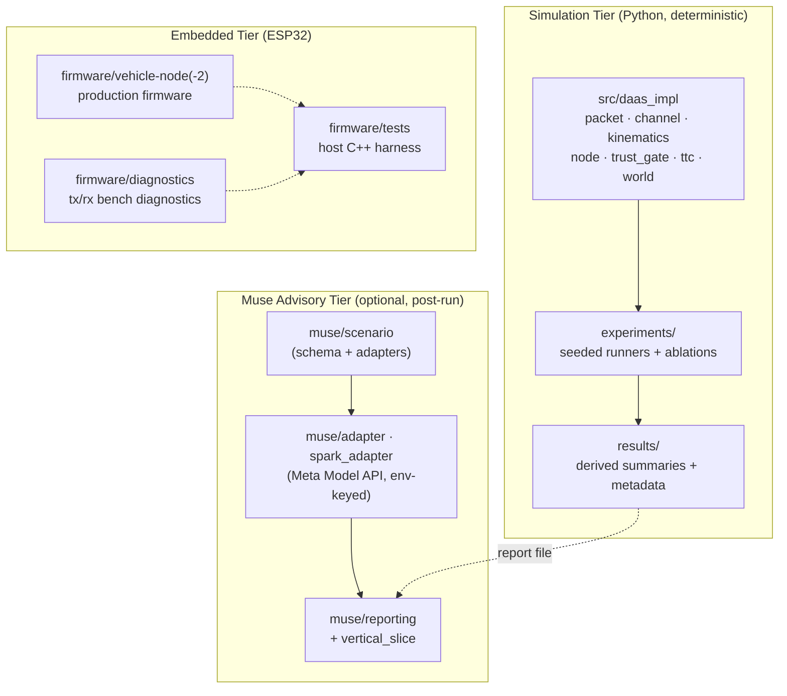

<div align="center">

# DAS Scenario Pilot

**Scenario-driven V2V/V2X simulation, reproducible communication experiments, a Meta Muse advisory layer, and ESP32 diagnostic tooling.**

Internal/legacy identifiers `DAAS` / `DAAS-V2V` are preserved in code where renaming would break compatibility.

[](LICENSE)

*An independent research project. Not affiliated with, endorsed by, or sponsored by Meta Platforms, Inc.*

</div>

---

## What this is

DAS Scenario Pilot grew out of the Smart India Hackathon 2026 problem statement
**SIH26007** (safe operation of mine vehicles in fog/low-visibility open-cast
iron-ore mines). It is a research and bench-validation platform with three
loosely coupled layers:

1. **Deterministic Python simulation core** (`src/daas_impl/`) — packet wire
   format, channel/degradation models, kinematics, node behaviour, trust
   gating, TTC risk math, and run I/O.
2. **Reproducible experiments** (`experiments/`, `results/`) — seeded
   simulation runners (density adaptation, perception fusion, integrity,
   fallback, message-age/TTC, 2×2 ablation) with committed summary outputs.
3. **Meta Muse advisory layer** (`muse/`) — scenario schema, model adapter,
   vertical slice, and reporting. Muse is strictly **advisory/post-run**:
   it can never modify simulation metrics or control any physical output.
4. **ESP32 firmware** (`firmware/`) — production vehicle-node firmware, host
   C++ test harnesses, and the H4 diagnostic sketches used for bench
   validation of the ESP-NOW link.

**Intended users:** researchers and engineers studying V2V/V2X message
protocols, safety-layer isolation, and reproducible simulation methodology;
hackathon/education users who want a complete, honest reference stack.

## Status labels (evidence discipline)

| Component | Label | Basis |
|---|---|---|
| Python simulation core + unit tests | `SIMULATION_VERIFIED` | 33/33 unit tests pass (stdlib `unittest`) |
| Muse suite (offline/sandbox) | `SIMULATION_VERIFIED` | 41/41 pass; vertical-slice sandbox demo reproduced |
| Firmware host C++ tests | `SIMULATION_VERIFIED` | 5 suites + VS1 host check pass (g++) |
| Diagnostic ESP32 sketches | `COMPILE_VERIFIED` | compiled against Arduino-ESP32 core 3.3.11, FQBN `esp32:esp32:esp32` |
| Diagnostic firmware on boards | `USER_REPORTED_FLASHED` | user reports both sketches flashed; boot banners observed for identity/channel; **full physical E2E (sensor→TX→RX→ACK→display) evidence still pending** |
| Production vehicle-node firmware | `NOT COMPILE-VERIFIED ON CORE 3.x` | known ESP-NOW 3.x callback-signature incompatibility, documented in `docs/VALIDATION_STATUS.md` |
| Road/vehicle operation | `NOT VALIDATED — NEVER CLAIMED` | research prototype only |

## Architecture overview



- **Advisory isolation:** the Muse path reads completed run reports and emits
  review text. It has no code path into `src/daas_impl` metrics or into any
  firmware/actuation logic. A one-advisory-request-per-completed-run pattern
  is used by the vertical slice; no live API call happens without explicit
  configuration and user action.
- **Physical path (bench diagnostics):** ultrasonic sensor → TX packet
  (32-byte frame, CRC16-CCITT) → ESP-NOW → RX length/field/CRC validation →
  application ACK → TX ACK correlation → OLED/LED indicators. Status:
  `USER_REPORTED_FLASHED`; end-to-end bench evidence is being collected
  separately and is **not** claimed here.

## Quick start (no hardware required)

Requirements: Python 3.11+ (standard library only for tests; no pip install
needed for the simulation/tests in this snapshot).

```bash
# 1) Core unit tests (33 tests)
python3 tests/run_unit_tests.py

# 2) Muse suite (41 tests)
python3 muse/tests/run_tests.py

# 3) Offline Muse vertical slice (sandboxed; no API key, no writes to results/)
python3 -m muse.vertical_slice muse/scenarios/vertical_slice_base.json --sandbox

# 4) Firmware host tests (needs g++ or clang++; no ESP32 hardware)
python3 firmware/tests/run_tests.py
```

Latest local verification of this snapshot (2026-11-05, from the published
tree): 33/33 core unit tests OK · 41/41 Muse tests PASS · vertical-slice
sandbox PASS · `vs1_hostcheck` PASS · `test_wire_protocol` and
`test_safety_isolation` compiled with g++ and passed.

## Configuration (environment variables)

The Muse adapter reads only these names at runtime (verified in
`muse/adapter.py` / `muse/spark_adapter.py`). Copy `.env.example` to `.env`
and fill values locally; **never commit real values**:

| Variable | Purpose |
|---|---|
| `MUSE_MODEL_API_URL` | Meta Model API endpoint base URL |
| `MUSE_MODEL_API_KEY` | secret key — local only |
| `MUSE_MODEL_NAME` | model name to request |
| `MUSE_MODEL_TIMEOUT_S` | request timeout (seconds) |
| `MUSE_MODEL_MAX_TOKENS` | response token cap |

No live Meta API request is made by tests; live smoke (`muse/live_smoke.py`)
is opt-in and skipped without credentials.

## ESP32 hardware

See `firmware/diagnostics/README_MANUAL_FLASH.md` for the bench diagnostic
setup (manual flashing only; COM-port names in that file are illustrative —
yours will differ). Summary of the validated configuration:

- Board target FQBN `esp32:esp32:esp32`, Arduino-ESP32 core **3.3.11**,
  serial **115200** baud.
- Wire protocol: packed 32-byte `v2v_packet_t`, magic `0xD4`, CRC16-CCITT
  (poly 0x1021, init 0xFFFF) over bytes 0x00–0x1D, monotonic `seq_num`.
- ESP-NOW channel 1 on both diagnostic nodes; TX peer MAC must be set to the
  **actual RX boot-banner MAC** — never a placeholder, and never a real MAC
  published in a repository.
- Buzzer is disabled by default (`BUZZER_ENABLE 0`) pending wiring
  verification.
- Production firmware in `firmware/vehicle-node*/` targets the older
  ESP-NOW callback API and **does not compile unmodified on core 3.x**;
  this is documented, not silently patched.

**Honest limitation:** nothing in this repository should be interpreted as
automotive-grade safety validation. No road testing, braking control,
collision-avoidance guarantee, or certification is claimed. See
`docs/SAFETY_AND_LIMITATIONS.md`.

## Repository layout

```
.
├── src/daas_impl/        # deterministic simulation core (Python)
├── experiments/          # seeded, reproducible experiment runners
├── muse/                 # Meta Muse advisory layer (schema/adapter/slice)
├── firmware/             # common headers, vehicle-node(-2), diagnostics, host tests
├── tests/                # core unit tests
├── scripts/              # analysis / figure / manifest helpers
├── results/
│   ├── derived/          # seeded experiment summary JSONs
│   ├── metadata/         # per-run metadata sidecars
│   └── reports/          # human-readable verified reports (subset)
├── docs/                 # architecture/protocol/validation/project docs
├── LICENSE               # Apache-2.0 (exact text)
├── NOTICE                # attribution + third-party/Meta boundary
└── .env.example          # blank placeholders only
```

Not included in this public snapshot (deliberately): the host-side ML
training pipeline (`ml/` in the internal tree), photographs/media,
presentation decks, raw per-packet CSVs, raw serial captures, hardware
evidence containing device identifiers, third-party PDFs, and backup
archives. See `EXPORT_MANIFEST.md` for the full included/excluded register
with reasons.

## Documentation map

| Topic | Doc |
|---|---|
| Validation status per component | `docs/VALIDATION_STATUS.md` |
| Safety & limitations | `docs/SAFETY_AND_LIMITATIONS.md` |
| Licensing scope | `docs/LICENSING.md` |
| Third-party / dependency terms | `docs/THIRD_PARTY_LICENSES.md` |
| Wire protocol details | `docs/protocol/message-schema.md` |
| System architecture | `docs/architecture/system-architecture.md` |
| Experiment metrics | `docs/experiments/metrics.md` |
| Validation plan (baselines) | `docs/validation/validation-plan.md` |
| Project origin (SIH26007) | `docs/problem-statement/SIH26007.md` |
| Hardware bench flash guide | `firmware/diagnostics/README_MANUAL_FLASH.md` |

## Results you can reproduce

`results/derived/` and `results/metadata/` contain seeded summary/metadata
JSONs produced by the committed runners (e.g. the `ABL2X2` 2×2 ablation over
seeds 8001–8003). The runners in `experiments/` regenerate them deterministically.
Numerical headline claims from earlier internal documents are **not** carried
into this README unless they were reproduced from committed data in this
snapshot; keep `results/reports/*.md` as the verified starting point.

## License and citation

Code and project-authored documentation: **Apache-2.0** (see `LICENSE`,
`NOTICE`, `docs/LICENSING.md`). Third-party components keep their own terms.
Meta API/model access is governed by Meta's own terms and is not licensed by
this repository.

Citation file: `CITATION.cff`.

## Contributing & security

See `CONTRIBUTING.md`, `CODE_OF_CONDUCT.md` (Contributor Covenant), and
`SECURITY.md` (please report vulnerabilities privately; do not open public
issues with exploit details).

## Roadmap / known limitations

- Complete the physical bench E2E evidence chain for the diagnostic firmware
  (sensor → TX → RX → ACK → display) before any `HARDWARE_BENCH_VERIFIED`
  label is used.
- Port production firmware to the Arduino-ESP32 core 3.x ESP-NOW API
  (tracked, deliberate; not silently patched).
- Publish the ML pipeline as a separate, dependency-pinned module once its
  data/model licensing is confirmed.
- Full docs set (ARCHITECTURE/DATA_FLOW/V2V_PROTOCOL/EXPERIMENTS/MUSE/
  HARDWARE_SETUP) is being expanded post-snapshot.
