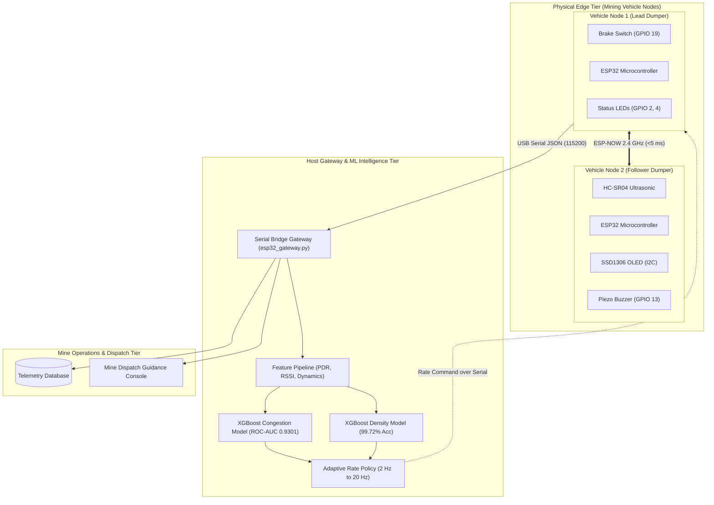
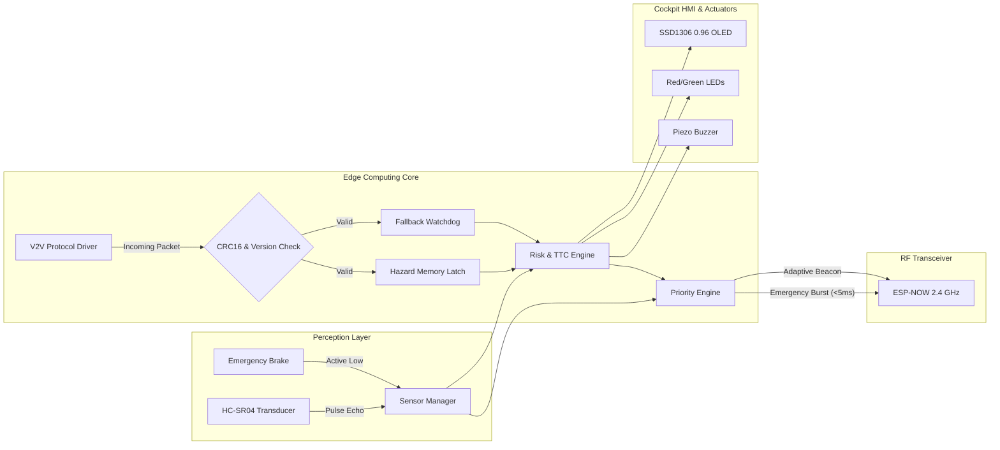
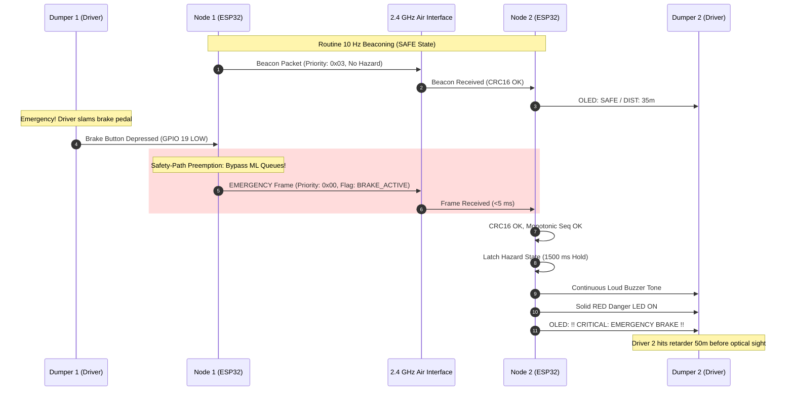
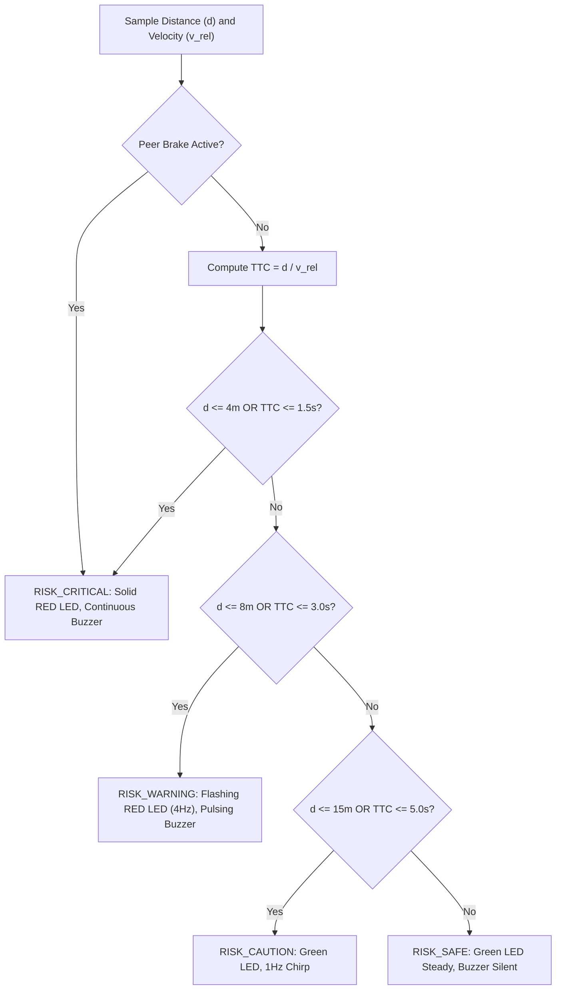
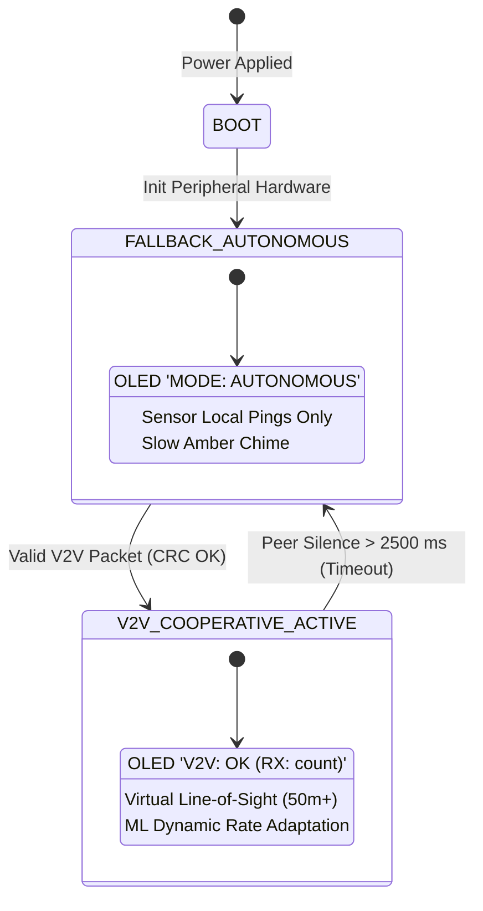
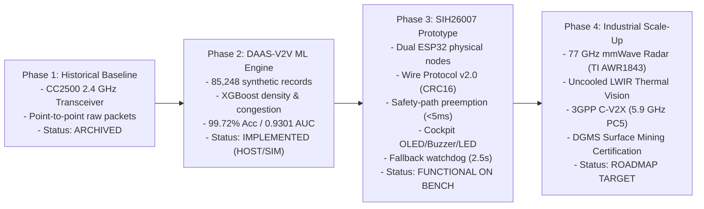

# System Architecture Diagrams (Mermaid Reference)

**Project:** DAAS-V2V / SIH26007 Cooperative Mine Safety System  
**Document Type:** Visual Systems Architecture Specification  

---

## 1. Multi-Tier System Architecture

---

## 2. Vehicle Node Embedded Block Diagram

---

## 3. V2V Emergency Preemption Sequence Diagram

---

## 4. Edge Collision Risk Decision Flowchart

---

## 5. Fail-Safe Fallback State Machine

---

## 6. Technology Evolution & Research Lineage

